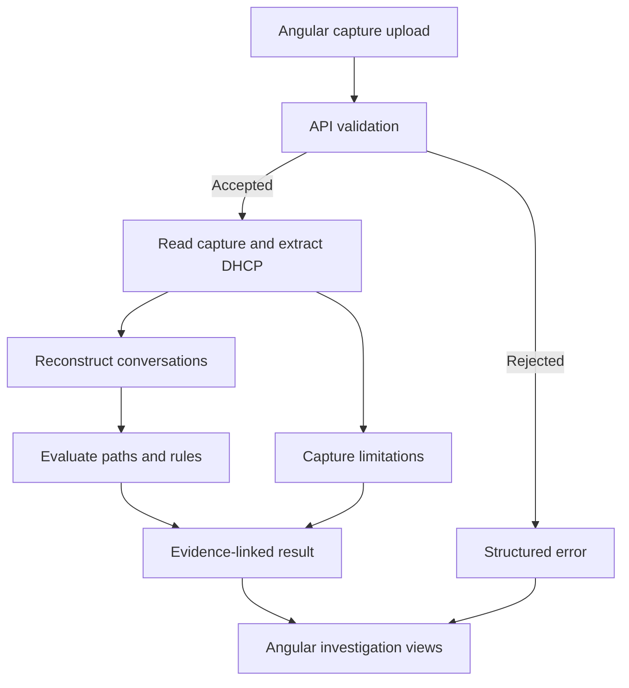

# ProtocolLens

**A deterministic protocol troubleshooting workbench.**

Turn packet captures into evidence-backed protocol execution traces. Reconstruct conversations, compare observed behaviour with valid protocol paths, and investigate deviations without losing sight of what the capture actually proves.

Built with **C# / ASP.NET Core** and **Angular 20 / TypeScript**. The completed baseline focuses on **DHCPv4**; additional protocols follow the same evidence-first approach.

> **Documentation status:** Written as the README for the completed DHCPv4 release. Because no implementation was supplied, repository paths, APIs, configuration, and commands are reference conventions to align with the actual code. Examples are illustrative; test and performance results are not claimed.

[Overview](#overview) · [Capabilities](#capabilities) · [Investigation workflow](#investigation-workflow) · [Analysis model](#analysis-model) · [Architecture](#architecture) · [Getting started](#getting-started) · [API](#api) · [Testing](#testing-and-quality) · [Roadmap](#roadmap)

## Overview

A packet capture records network traffic. Understanding it requires more than locating individual packets: an engineer must identify related messages, reconstruct the exchange, account for alternate protocol paths, and distinguish a genuine contradiction from incomplete visibility.

ProtocolLens makes that reasoning inspectable. It helps answer five questions:

1. **What was observed?** Identify the messages, fields, timestamps, and capture frames supporting an investigation.
2. **Which conversation do they belong to?** Separate clients, exchanges, retries, and competing server responses.
3. **What behaviour was expected?** Evaluate the applicable protocol path and its prerequisites.
4. **Where does the evidence diverge?** Surface missing observations, inconsistent fields, and supported rule violations.
5. **What should be checked next?** Suggest focused investigations while keeping hypotheses separate from facts.

The core differentiator is **deterministic conversation reconstruction and protocol interpretation**, not an AI-generated summary of packet contents.

### Intended users

Network and application engineers, developers debugging connectivity-dependent systems, test engineers validating protocol behaviour, and learners who want to connect protocol theory with captured traffic.

### Product boundaries

ProtocolLens complements Wireshark: use ProtocolLens to inspect a reconstructed exchange and Wireshark to examine the original packets in depth.

It is not a general-purpose packet dissector, continuous monitoring platform, SOC product, device manager, or network remediation system. The baseline does not capture live traffic, modify network configuration, or transmit diagnostic packets.

## Capabilities

| Capability | What it provides |
| --- | --- |
| Capture ingestion | Validates a bounded PCAP upload and reports capture metadata, packet counts, and analysis limitations. |
| DHCP extraction | Converts supported packet data into typed DHCP messages while retaining frame-level provenance. |
| Conversation reconstruction | Separates concurrent exchanges and handles repeated messages, multiple offers, and uncertain associations. |
| Protocol interpretation | Evaluates the applicable DHCP path instead of forcing every exchange through a single fixed sequence. |
| Deterministic findings | Produces stable rule identifiers, supporting evidence, observation windows, and investigation guidance. |
| Visual investigation | Presents conversation summaries, message timelines, relevant fields, and expected-versus-observed comparisons. |
| Layered explanations | Offers Quick, Engineer, and Learn views over the same structured result. |
| Portable results | Exports structured JSON with analysis metadata and evidence references. |
| Local operation | Runs without an LLM, cloud account, database, or external analysis service. |

### Supported baseline

| Area | Supported scope | Boundary |
| --- | --- | --- |
| Capture container | Classic `.pcap`, including supported byte-order and timestamp-resolution variants | PCAPNG is a roadmap item, even if the underlying reader can open it. |
| Link and network layers | Ethernet, a single 802.1Q VLAN tag, IPv4, UDP | Other link types, nested encapsulations, and IP fragment reassembly are outside the baseline. |
| Protocol | DHCPv4 | DHCPv6 and BOOTP-only exchanges are not analyzed as DHCPv4. |
| Message recognition | DISCOVER, OFFER, REQUEST, ACK, NAK, DECLINE, RELEASE, INFORM | Recognition does not imply exhaustive validation of every extension or vendor option. |
| Exchange analysis | Initial allocation, reboot validation, renewal/rebinding candidates, and INFORM exchanges | Path classification remains uncertain when the necessary context is absent. |
| Relay visibility | Preserves relay address and observed VLAN context for correlation | Does not reconstruct an unseen relay topology or assume the Ethernet sender is the DHCP client. |
| Capture coverage | Complete visible paths, partial paths, retries, and concurrent conversations | Does not assume that all relevant network traffic was captured. |

Unknown options remain inspectable as bounded raw values. Option decoding respects option-overload and concatenation rules before validating known option lengths. Unsupported encodings produce an explicit limitation; they are not silently treated as missing options. See the [protocol references](#references).

## Investigation workflow

1. **Select a capture.** Upload an authorized synthetic, home-lab, or public educational PCAP.
2. **Check capture coverage.** Review decoded, skipped, unsupported, and malformed packet counts before interpreting results.
3. **Choose a conversation.** Inspect its client identity, transaction ID, participants, time range, and correlation status.
4. **Follow the timeline.** Examine each observed message and the protocol path it supports.
5. **Inspect a finding.** Read the rule, frame references, expected behaviour, observation window, and limitations.
6. **Verify the evidence.** Open the same original capture in Wireshark and inspect the referenced frame numbers.
7. **Export the result.** Save the JSON report when a reproducible investigation record is needed.

### Example: REQUEST without an observed response

The following is a synthetic example. Elapsed time is measured from the first DHCP message in the conversation.

| Frame | Elapsed time | Observed message | Relevant evidence |
| --- | --- | --- | --- |
| 12 | 0.000 s | DHCPDISCOVER | Client `02:00:00:00:00:01`, transaction `0x39a2f17c` |
| 15 | 0.184 s | DHCPOFFER | Server identifier `192.0.2.1`; offered address `192.0.2.100` |
| 18 | 0.610 s | DHCPREQUEST | Requested address `192.0.2.100`; selected server `192.0.2.1` |

The capture ends at 8.610 s. No matching ACK or NAK is observed during the remaining 8.000 s.

**Finding:** No corresponding DHCPACK or DHCPNAK was observed after frame 18, within the available capture window.

**What this establishes:** The capture contains the request and no decodable, correlated response within the stated window.

**What it does not establish:** Whether the server received the request, whether a response existed elsewhere, whether the client received it, or whether the client eventually obtained an address.

**Next investigations:** Check the capture position and duration, then compare relay forwarding, VLAN placement, filtering, and server logs where available.

### Explanation views

| View | Purpose | Example |
| --- | --- | --- |
| Quick | Identify the immediate finding | “ACK/NAK not observed after REQUEST.” |
| Engineer | Inspect the basis for the finding | Frame references, correlation fields, applicable rule, timing, and visibility limitations. |
| Learn | Understand the protocol concept | Why this kind of REQUEST expects a response and why missing traffic is not proof of server failure. |

All three views use the same analysis. Changing explanation depth does not change the underlying result.

## Evidence model

ProtocolLens keeps three kinds of statements separate:

| Evidence class | Meaning | Example |
| --- | --- | --- |
| **Observed evidence** | A value or message is present in the capture. | “Frame 18 contains DHCPREQUEST with transaction ID `0x39a2f17c`.” |
| **Missing observation** | An expected matching message was not found within a stated, analyzable window. | “No corresponding ACK/NAK was observed before capture end.” |
| **Inference** | A possible explanation that requires additional evidence. | “A relay or filtering issue could explain the missing response.” |

A deterministic rule assessment connects evidence to an explicit predicate. It is not a claim that every network event or internal device state is visible.

### Analysis guarantees

- **Traceable findings:** Each finding identifies its rule and supporting frames. Missing-observation findings additionally specify the searched time range and why that range ended.
- **No invented messages:** The expected path is displayed separately from captured messages. An expected event never receives a fabricated frame number or timestamp.
- **Explicit uncertainty:** Ambiguous correlation and insufficient visibility remain visible in the result.
- **Stable analysis:** Identical capture bytes, analyzer version, ruleset, and analysis options produce the same semantic result. Run IDs and processing timestamps are excluded from deterministic comparisons.
- **Preserved provenance:** Frame numbers refer to the original, unfiltered capture. Original timestamp precision is retained; display formatting does not imply additional precision.
- **Bounded claims:** An observed ACK is not proof that the client applied the configuration or that DNS, a gateway, or an application is reachable.

Severity describes investigation priority. It does not measure certainty, and the UI does not present invented confidence percentages.

## Analysis model

### 1. Read and normalize

The capture reader handles the PCAP container. Packet decoding identifies the supported link, network, and transport layers. DHCP extraction then produces typed messages with only the fields needed for reconstruction and inspection.

| Field group | Examples |
| --- | --- |
| Provenance | Original frame number, capture timestamp, captured length, original length |
| Transport context | Source/destination IP addresses and UDP ports |
| Client identity | Client identifier option as opaque bytes; hardware type, hardware length, and client hardware address when usable |
| Transaction context | Transaction ID, DHCP message type, flags, elapsed-client-time field |
| Address context | `ciaddr`, `yiaddr`, `giaddr`, requested address, server identifier |
| Configuration | Subnet mask, routers, DNS servers, lease duration, renewal and rebinding values |
| Decode quality | Truncation, unsupported content, malformed fields, and option-level warnings |

The parser preserves facts. It does not decide whether a conversation succeeded.

### 2. Reconstruct conversations

A conversation is one bounded DHCP exchange or related attempt sequence. It is not every packet from a MAC address, and a transaction ID alone is not globally unique.

Correlation considers:

- **Client identity:** Prefer a usable client identifier; use validated hardware-address context when necessary. A client identifier is not assumed to be a MAC address.
- **Transaction:** Use `xid` to identify candidates, then validate the remaining context.
- **Network context:** Preserve VLAN and relay information where present. Missing context is unknown, not evidence that two packets belong together.
- **Message compatibility:** Check whether message type, selected server, and address fields are compatible with the candidate exchange.
- **Episode boundaries:** Use observed terminal events, new attempts, and a documented inactivity policy to avoid merging unrelated reuse of identifiers.

Replies without an echoed client identifier can still be associated when other fields identify one compatible candidate. Conflicting identifiers are not overridden merely because `xid` matches. Multiple compatible candidates remain ambiguous.

Multiple offers remain in the same initial-allocation conversation; the selected server becomes relevant when a selecting REQUEST is observed. Repeated messages remain visible with their own frame references. Repetition alone does not prove whether a packet was retransmitted or duplicated by the capture arrangement.

Capture order is preserved. Timestamp reversals are flagged instead of silently rewriting the history into a cleaner sequence.

### 3. Select the applicable protocol path

Initial allocation commonly follows DISCOVER, OFFER, REQUEST, then ACK or NAK. That is one DHCP path, not a universal template.

| Path | Analysis behaviour |
| --- | --- |
| Initial allocation | Retains multiple offers and evaluates the request's selected-server and address context. |
| Reboot validation | Accepts a REQUEST-led path when its fields support it; does not invent a missing DISCOVER. |
| Renewal / rebinding | Uses message fields, destinations, and visible history to identify compatible paths; does not require a fresh OFFER. |
| Configuration information | Associates INFORM with ACK without interpreting that ACK as a new lease allocation. |
| DECLINE / RELEASE | Records the observed message without inventing an ACK requirement. |
| Partial or ambiguous trace | Preserves supported candidate paths and withholds conclusions requiring unavailable context. |

The engine models possible protocol progress from visible traffic. It cannot directly observe the client's internal state machine or prove that lease timers fired from one isolated REQUEST.

### 4. Evaluate rules

Rules have stable identifiers, explicit prerequisites, an evidence predicate, and a bounded result. A rule that lacks its required context reports insufficient evidence or does not run.

| Rule ID | Assessment | Interpretation boundary |
| --- | --- | --- |
| `DHCP-001` | No OFFER observed after DISCOVER | Describes the available window, not server availability. |
| `DHCP-002` | No selecting REQUEST observed after an OFFER | Does not establish that the client received or rejected that offer. |
| `DHCP-003` | No matching ACK/NAK observed after an applicable REQUEST | Does not identify the responsible host or network segment. |
| `DHCP-004` | Matching NAK observed | An observed negative response, not automatically a protocol violation. |
| `DHCP-005` | Required field or option contradicts a supported path rule | Applied only when decoding and path prerequisites are satisfied. |
| `DHCP-006` | Packet has ambiguous conversation membership | Preserves candidates instead of assigning it arbitrarily. |
| `DHCP-007` | Repeated compatible message observed | Keeps all evidence and avoids equating repetition with packet loss. |
| `CAPTURE-001` | Capture quality limits analysis | Identifies truncation, undecodable data, or uncertain chronology. |

Absence checks cover the relevant exchange window, not an arbitrary fixed “DHCP timeout.” A conversation inactivity threshold is an analysis policy, not an RFC-mandated failure deadline. If skipped or undecodable traffic could change a conclusion, dependent absence checks are suppressed or reported as insufficient evidence.

## Architecture

ProtocolLens uses one ASP.NET Core application and one Angular application. Responsibilities are separated by code boundaries without requiring independent services, queues, or a database.



### Responsibility boundaries

| Component | Owns | Does not own |
| --- | --- | --- |
| Upload component | File selection, upload state, user feedback | File trust decisions or DHCP rules |
| Angular API service | Typed HTTP requests and responses | Conversation reconstruction |
| API endpoint | Request validation, HTTP status, cancellation propagation | Packet interpretation |
| Analysis service | Pipeline coordination and resource lifecycle | UI formatting or individual rule predicates |
| Capture reader | Capture records, timestamps, link type, original frame numbering | DHCP state |
| DHCP extractor | Typed fields and decoding diagnostics | Conversation outcomes |
| Conversation builder | Correlation, candidate exchanges, episode boundaries | Natural-language diagnosis |
| DHCP analyzer | Path evaluation, rule results, evidence references | HTTP or Angular state |
| Result mapper | Versioned response DTOs | Re-running or changing analysis decisions |
| Investigation views | Timelines, evidence inspection, explanation depth | Recalculating backend findings |

The analyzer operates on normalized messages so its important logic can be tested without HTTP, browser state, or native packet-reader dependencies.

### Technology choices

| Area | Technology | Purpose |
| --- | --- | --- |
| Backend | C# and ASP.NET Core Web API | Upload handling, orchestration, deterministic analysis, JSON contracts |
| Frontend | Angular 20 and TypeScript | Standalone components, typed services, investigation views |
| UI state and HTTP | Angular signals, HttpClient, and RxJS where needed | Local view state and request lifecycle |
| Capture reading | SharpPcap | Offline capture ingestion through its supported native backend |
| Packet decoding | PacketDotNet | Ethernet, IP, and UDP dissection |
| Protocol logic | Project-owned DHCP extraction, correlation, and rules | Behaviour that defines ProtocolLens |
| Verification | .NET tests and Angular tests | Rule correctness, integration contracts, and UI behaviour |

SharpPcap and PacketDotNet are the reference parser choices for this draft. Their ability to decode a format does not automatically make that format part of ProtocolLens's validated support matrix. DHCP interpretation remains project-owned; this README does not assume a dependency implements the complete DHCP analyzer.

### Repository layout

The following paths are the conventions used by the setup examples. They describe logical responsibilities, not a requirement to introduce additional architectural layers.

| Path | Responsibility |
| --- | --- |
| `ProtocolLens.sln` | Backend solution and test projects |
| `global.json` | Pinned .NET SDK selection |
| `src/ProtocolLens.Api/Program.cs` | Application startup and dependency registration |
| `src/ProtocolLens.Api/Endpoints/` | Upload, analysis, and health endpoints |
| `src/ProtocolLens.Api/Contracts/` | Request, response, and error DTOs |
| `src/ProtocolLens.Api/Captures/` | Capture validation, reading, and provenance |
| `src/ProtocolLens.Api/Dhcp/` | Message models, extraction, reconstruction, and analysis |
| `src/ProtocolLens.Api/Analysis/` | Pipeline coordination and result composition |
| `src/protocollens-web/src/app/` | Angular upload and investigation features |
| `src/protocollens-web/proxy.conf.json` | Local development API proxy |
| `tests/ProtocolLens.Tests/` | Unit and integration tests |
| `tests/fixtures/dhcp/` | Authorized captures and expected semantic results |

## Getting started

These commands assume the reference layout above. A release must verify them against its actual repository before publication.

### Prerequisites

- The .NET SDK selected by `global.json` and compatible with the API's target framework.
- Node.js compatible with the pinned Angular 20 minor version. Node.js 24 is one compatible major line; pin an exact supported patch in the repository's tooling configuration.
- npm and the committed frontend lockfile.
- The native capture-reading dependency required by the selected SharpPcap package: Npcap on Windows or the appropriate libpcap package on supported Unix environments.
- A browser and, optionally, Wireshark for independent packet inspection.

Use the [Angular compatibility table](https://angular.dev/reference/versions) for exact Node.js, TypeScript, and RxJS ranges. Use the repository-pinned dependencies rather than installing an arbitrary global Angular CLI. Native library requirements still apply when using the offline file reader; live interface capture is not required.

### Start the backend

From the repository root:

```bash
dotnet restore ProtocolLens.sln
dotnet build ProtocolLens.sln --no-restore
dotnet run --project src/ProtocolLens.Api --no-launch-profile -- --environment Development --urls http://127.0.0.1:5080
```

The reference API listens at `http://127.0.0.1:5080`. Local HTTP is a development convention.

### Start the frontend

In a second terminal:

```bash
cd src/protocollens-web
npm ci
npm start -- --host 127.0.0.1 --port 4200 --proxy-config proxy.conf.json
```

The `start` script maps to the project's local `ng serve`. The reference `proxy.conf.json` routes API requests to the backend:

```json
{
  "/api/**": {
    "target": "http://127.0.0.1:5080"
  }
}
```

Open `http://127.0.0.1:4200`. The Angular service uses relative `/api/...` URLs, allowing the development proxy and a same-origin deployed configuration to share the same client contract.

### Run an example

Use `tests/fixtures/dhcp/initial-allocation-ack.pcap` for a complete visible allocation path and `tests/fixtures/dhcp/request-without-response.pcap` for a bounded missing-response example. These fixture names are part of the reference repository contract and must be supplied with the implementation.

The first should display an observed ACK. The second should identify the missing observation and its capture window without declaring a server failure.

## API

The baseline processes one bounded capture per request. It returns the completed result synchronously and does not create a durable server-side analysis record.

| Method | Endpoint | Request | Result |
| --- | --- | --- | --- |
| `GET` | `/api/health` | None | Minimal process-health response; not a substitute for an end-to-end parsing check |
| `POST` | `/api/analyses/dhcp` | `multipart/form-data`, one field named `file` | Versioned analysis result or a structured error |

### Upload example

Run from the repository root with curl. On Windows PowerShell, use `curl.exe` if `curl` resolves to a shell alias.

```bash
curl --fail-with-body -F "file=@tests/fixtures/dhcp/request-without-response.pcap" http://127.0.0.1:5080/api/analyses/dhcp
```

The server verifies the container and resource limits. A `.pcap` extension or browser MIME type is not sufficient validation.

### Result contract

The full response contains capture identity and counts, analyzer/ruleset versions, effective analysis options, coverage warnings, reconstructed conversations, normalized message references, and findings.

Processing status, correlation status, and exchange outcome are separate. A successful HTTP request can legitimately return incomplete or ambiguous protocol evidence. `CompletedWithWarnings` describes processing or coverage limitations; a protocol finding with warning severity does not by itself mean processing was incomplete.

| Dimension | Example values | Meaning |
| --- | --- | --- |
| Processing status | `Completed`, `CompletedWithWarnings` | Whether the accepted capture was processed within the supported contract |
| Correlation status | `Resolved`, `Ambiguous`, `Unmatched` | Whether message association can be supported |
| Exchange outcome | `AckObserved`, `NakObserved`, `NoResponseObserved`, `NoReplyExpected`, `Undetermined` | What the visible exchange establishes |
| Sequence coverage | `FullForSelectedPath`, `Partial`, `Unknown` | How much of the selected path is visible; never a claim that the entire network was captured |

The following abridged JSON corresponds to the synthetic example above. It illustrates the contract rather than output from a measured run.

```json
{
  "schemaVersion": "1.0",
  "analyzerVersion": "reference",
  "ruleSetVersion": "dhcpv4-baseline",
  "processingStatus": "Completed",
  "capture": {
    "frameCount": 42,
    "dhcpMessageCount": 3,
    "firstTimestamp": "2026-01-01T10:00:00.000Z",
    "lastTimestamp": "2026-01-01T10:00:08.610Z"
  },
  "conversations": [
    {
      "id": "dhcp-001",
      "transactionId": "0x39a2f17c",
      "path": "InitialAllocation",
      "correlationStatus": "Resolved",
      "outcome": "NoResponseObserved",
      "sequenceCoverage": "Partial",
      "messageFrameNumbers": [12, 15, 18],
      "findings": [
        {
          "ruleId": "DHCP-003",
          "severity": "Warning",
          "evidenceType": "MissingObservation",
          "summary": "No matching DHCPACK or DHCPNAK was observed after DHCPREQUEST.",
          "evidenceFrameNumbers": [18],
          "expectedMessageTypes": ["DHCPACK", "DHCPNAK"],
          "observationWindow": {
            "start": "2026-01-01T10:00:00.610Z",
            "end": "2026-01-01T10:00:08.610Z",
            "durationMilliseconds": 8000,
            "endReason": "CaptureEnd"
          },
          "limitations": [
            "Capture position and packet-loss characteristics are unknown.",
            "Events after capture end are outside this result."
          ],
          "possibleExplanations": [
            {
              "evidenceType": "Inference",
              "text": "A response may not have crossed the observation point."
            }
          ],
          "nextSteps": [
            "Verify capture placement and duration.",
            "Compare authorized server-side or relay-side evidence."
          ]
        }
      ]
    }
  ]
}
```

Reports include a SHA-256 digest of the original capture so frame references can be tied to the correct input. A digest establishes file identity, not capture authenticity. Rule meaning changes require a ruleset-version change; incompatible response changes require a schema-version change.

### Error handling

| HTTP status | Reference condition | Behaviour |
| --- | --- | --- |
| `400` | Missing file, empty upload, invalid request | Reject before analysis. |
| `413` | Upload exceeds the configured byte limit | Reject without attempting the full analysis. |
| `415` | Unsupported container or capture link type | Identify the unsupported capability. |
| `422` | Corrupt container, packet/conversation limit exceeded, or analysis deadline reached | Return a stable error code; do not label a partial run complete. |
| `503` | Analysis concurrency limit reached or required reader unavailable | Return a retryable error where appropriate. |
| `500` | Unexpected internal failure | Return a trace identifier without stack traces or packet contents. |

Errors use a Problem Details-style JSON body with a stable application `code` and `traceId`. An individual malformed DHCP message may instead produce a frame-level warning when the reader can safely continue. A structurally valid capture with no DHCP returns an empty conversation list, not a server error.

## Configuration and resource limits

The following values are **reference defaults**, not measured capacity or throughput claims. They define conservative, bounded operation for the target single-instance application.

```json
{
  "Analysis": {
    "MaxUploadBytes": 26214400,
    "MaxCaptureRecords": 250000,
    "MaxDhcpMessages": 25000,
    "MaxConversations": 5000,
    "MaxConcurrentAnalyses": 2,
    "TimeoutSeconds": 30,
    "ConversationIdleGapSeconds": 120
  }
}
```

| Setting | Purpose |
| --- | --- |
| `MaxUploadBytes` | Limits the uploaded capture to 25 MiB. |
| `MaxCaptureRecords` | Bounds work even when individual packets are small. |
| `MaxDhcpMessages` / `MaxConversations` | Bounds retained analysis state and result size. |
| `MaxConcurrentAnalyses` | Prevents unbounded simultaneous parsing. |
| `TimeoutSeconds` | Defines the cooperative processing deadline. |
| `ConversationIdleGapSeconds` | Controls a correlation heuristic; it does not define a DHCP failure timeout. |

Configuration is read from ASP.NET Core settings and environment variables, such as `Analysis__MaxUploadBytes`. Invalid or contradictory limits fail startup. Upload limits must agree across the application, multipart parser, web server, and any reverse proxy, with room for multipart overhead.

Cancellation propagates through processing loops. A cooperative deadline cannot forcibly terminate a blocked native call; public or adversarial ingestion would require stronger process isolation and operating-system resource controls.

## Data handling and operation

### Capture lifecycle

- Raw captures are used only for the current analysis. Temporary files use application-generated names in a dedicated directory outside the web root.
- Temporary data is removed after success, failure, or cancellation. Interrupted-process leftovers are handled by startup cleanup scoped to that directory.
- The baseline has no server-side capture archive or result history. The browser holds the current result in memory until it is cleared or the page is closed.
- Exported reports are user-managed files and may contain IP addresses, device identifiers, and other sensitive metadata.
- File deletion is ordinary filesystem cleanup, not a guarantee of forensic erasure.

No capture bytes or structured findings are sent to an external AI provider. Analysis does not require outbound internet access after dependencies are installed.

### Deployment boundary

The baseline is a local, single-user workbench bound to loopback. Authentication and multi-user authorization are outside this release contract.

For a controlled deployment, serve the built Angular assets and API under one origin, use HTTPS where traffic leaves the local machine, run with least privilege, and restrict access to the intended operator. Treat broader network exposure as a separate deployment change requiring explicit access control, workload isolation, and retention decisions.

Deploy compiled frontend assets through a production web server rather than exposing the Angular development server.

### Diagnostics and performance

Operational logs record request/analysis identifiers, processing stages, counts, elapsed time, and categorized failures. Packet payloads, client identifiers, and full filenames are excluded from routine logs. The capture digest belongs in the result, not automatically in every log entry.

The processing design reads capture records sequentially and retains bounded DHCP analysis data. It does not claim constant memory: retained messages, correlation candidates, and result size all contribute to memory use.

Performance reports must state the capture size, total and DHCP packet counts, conversation count, operating system, hardware, dependency versions, concurrency, elapsed time, and peak memory. No speed or scale figure is published here without a reproducible measurement.

## Testing and quality

Correctness is established with deterministic fixtures and assertions about protocol meaning, not only whether a parser returns an object.

| Scenario | Required result |
| --- | --- |
| Complete visible allocation | Correlate the exchange and report an observed ACK without claiming end-to-end connectivity. |
| REQUEST with no visible response | Identify the bounded missing observation and retain capture limitations. |
| Capture beginning with REQUEST | Avoid inventing earlier messages or automatically flagging a missing DISCOVER. |
| Renewal or rebinding candidate | Use the applicable path and preserve uncertainty where history is missing. |
| Multiple clients sharing an `xid` | Keep identities separate; do not merge on transaction ID alone. |
| Multiple offers | Retain all offers and associate the selecting request correctly. |
| Repeated messages and late replies | Preserve frames; distinguish repetition, final visible outcome, and observation-window boundaries. |
| NAK, DECLINE, RELEASE, INFORM | Apply message-specific expectations rather than a universal ACK rule. |
| Missing or conflicting identifiers | Use supported fallback evidence or return ambiguity. |
| Truncated or malformed options | Produce bounded decoding diagnostics and suppress unsupported conclusions. |
| Timestamp reversal or capture gaps | Preserve original order and expose timing limitations. |
| No DHCP traffic | Return a valid empty result. |
| Limit exceeded or cancellation | Stop cleanly, release resources, and avoid reporting a completed analysis. |

### Verification layers

1. **Unit tests:** Normalized-message correlation, path selection, rule prerequisites, and evidence wording.
2. **Fixture tests:** PCAP input to expected semantic output, including provenance and negative cases.
3. **API integration tests:** Multipart handling, limits, status codes, DTO serialization, and cleanup.
4. **Frontend tests:** Loading, failure, empty, partial, and ambiguous results; evidence navigation and explanation views.
5. **Manual reference checks:** Compare selected frames and fields with Wireshark. Agreement with another tool is a cross-check, not a substitute for protocol reasoning.

Run backend checks from the repository root:

```bash
dotnet test ProtocolLens.sln
```

Run frontend checks from `src/protocollens-web`:

```bash
npm test -- --watch=false
npm run build
```

These commands assume the reference test scripts and a configured browser/test runner. Semantic snapshots exclude nondeterministic run metadata. Each fixture records its source or generation method, permitted use, expected outcome, and known capture limitations.

### Release verification

A release is ready to claim the documented behaviour only after a clean checkout can build, all documented fixtures pass, API examples match the implementation, resource limits and cleanup are exercised, supported operating systems are tested, and setup instructions are reproduced independently.

CI should enforce those checks and dependency review. Build badges, coverage figures, platform claims, and benchmark results belong in the README only when backed by actual published runs.

## Troubleshooting

| Symptom | Inspect first | Interpretation |
| --- | --- | --- |
| Native capture library cannot load | Required native dependency, process architecture, and package compatibility | Failure occurs before DHCP interpretation. |
| Upload rejected as unsupported | Actual file container and link type | Renaming PCAPNG to `.pcap` does not convert it. |
| Upload works but no DHCP appears | Decoded counts, skipped-frame warnings, and the original capture in Wireshark | A valid capture may contain no supported DHCP traffic. |
| Frontend cannot reach the API | Browser Network tab, backend address, and proxy configuration | Verify the HTTP boundary before changing analyzer code. |
| An exchange is incomplete | Capture start/end, observation point, and correlation evidence | Incompleteness is not proof of a broken DHCP server. |
| A result is ambiguous | Client identifier, hardware address, transaction reuse, relay/VLAN context | More evidence may be necessary; forcing a match would reduce correctness. |
| Processing stops at a limit | Stable error code and configured resource limits | Use a bounded capture or review the limit with measurements. |

Filtering or rewriting a capture creates a different input with different frame numbering. Re-run analysis on the exact file being inspected; do not compare frame references across different files as though they were identical.

## Known limitations

- Captures provide observations from a particular point and time, not a complete account of the network.
- A supported DHCP path may still be unclassifiable when identifying fields or earlier context are absent.
- The baseline does not perform general IP reassembly, multi-capture clock alignment, topology discovery, or exhaustive DHCP standards compliance certification.
- Checksum anomalies can arise from capture conditions, including offload; they are not automatically treated as on-wire corruption.
- Unknown extensions and vendor-specific behaviour are retained or flagged without inventing interpretation.
- DHCP evidence alone cannot validate address-conflict freedom, router forwarding, DNS resolution, internet access, or application availability.
- Captured identifiers are correlation evidence, not authenticated device identities.
- Cross-platform dependencies require a tested compatibility matrix; library portability alone does not prove application support.

## Roadmap

The completed DHCP baseline is the foundation. Enhancements are ordered by the engineering question they answer and the evidence required to answer it. This roadmap is not a delivery-date commitment.

| Priority | Enhancement | User value | Acceptance gate |
| --- | --- | --- | --- |
| 1 | Broader DHCP regression corpus | More reliable interpretation of diverse clients, relays, and option encodings | Every new rule has positive, negative, partial-capture, and ambiguous cases. |
| 1 | PCAPNG and additional link types | Analyze more real-world capture formats | Preserve interface identity and timestamp resolution; never merge incompatible clock domains silently. |
| 1 | Measured performance and improved large-result navigation | Keep analysis and the UI responsive within explicit limits | Publish reproducible measurements before increasing capacity claims. |
| 2 | ARP conversation analysis | Inspect address-resolution requests, replies, and conflicting address claims | Account for gratuitous/probe traffic and distinguish observed claims from a confirmed conflict. |
| 3 | ICMP and gateway investigation | Relate reachability evidence to address resolution and routing context | Handle absent replies, visible errors, and unknown topology without declaring an unproven outage. |
| 4 | TCP conversation analysis | Reconstruct handshakes, connection closure, resets, and retransmission candidates | Handle sequence numbers, partial streams, capture duplication, and visibility limits. |
| 5 | Capture comparison and report improvements | Compare known-good and problematic exchanges and produce reviewable investigation reports | Preserve provenance and make unmatched or incomparable evidence explicit. |
| 5 | CLI and batch analysis | Reuse the same deterministic engine in repeatable local workflows | CLI and API produce equivalent semantic results under identical options. |
| Later | Optional AI explanation | Explain existing findings in different language or at different depths | Deterministic output remains authoritative and fully usable with AI disabled. |

### Extension principles

Add a new protocol when its concrete requirements are understood. Reuse capture provenance, result contracts, and UI patterns where they genuinely fit; introduce shared analyzer interfaces only after multiple implementations reveal a stable common boundary.

Cross-protocol findings must identify every supporting observation. For example, “DHCP ACK observed, gateway ARP reply not observed” remains two bounded statements until additional evidence justifies a stronger conclusion. User-supplied topology or configuration is labeled as supplied context, not captured fact.

### Optional AI boundary

Any future AI feature receives an approved, minimal structured result after deterministic analysis. It may explain findings and suggest questions. It cannot create packets, change correlation, determine protocol state, suppress limitations, or override rule outcomes.

AI-generated text is visibly labeled. External processing is opt-in, and the user can inspect what would be sent. An unavailable model must not prevent capture analysis or access to the deterministic explanation views.

Authentication, persistent workspaces, live capture, distributed processing, and automated remediation are not default roadmap commitments. Each requires a demonstrated product need and a separate design decision.

## Contributing

Keep changes focused on reproducible behaviour and understandable boundaries.

For a protocol bug, include the expected behaviour, actual result, analyzer/ruleset version, relevant frame numbers, and an authorized minimal capture or synthetic reproduction. Explain whether the issue concerns parsing, correlation, protocol interpretation, or presentation.

For a new rule, document its protocol reference, prerequisites, exact evidence predicate, limitations, and regression cases. Do not add a diagnostic that sounds decisive but cannot be supported by its evidence.

Use synthetic, personal-lab, or appropriately licensed public fixtures. Never submit employer-proprietary source, internal captures, customer traffic, credentials, or confidential configurations. For a security issue, use the repository's designated private reporting channel once configured; do not publish sensitive evidence in an issue.

## References

### Protocol specifications

- [RFC 2131 — Dynamic Host Configuration Protocol](https://www.rfc-editor.org/rfc/rfc2131.html): Core DHCPv4 exchanges and client/server behaviour.
- [RFC 2132 — DHCP Options and BOOTP Vendor Extensions](https://www.rfc-editor.org/rfc/rfc2132.html): Base option definitions, client identifiers, and option overload.
- [RFC 3396 — Encoding Long Options in DHCPv4](https://www.rfc-editor.org/rfc/rfc3396.html): Option concatenation and decoding across option fields.
- [RFC 4361 — Node-specific Client Identifiers for DHCPv4](https://www.rfc-editor.org/rfc/rfc4361.html): Client-identifier semantics beyond hardware addresses.
- [RFC 6842 — Client Identifier Option in DHCP Server Replies](https://www.rfc-editor.org/rfc/rfc6842.html): Updated reply handling and identifier correlation considerations.

Rules cite the applicable specification and relevant updates; implementing a subset is not a claim of complete RFC conformance.

### Engineering references

- [SharpPcap](https://github.com/dotpcap/sharppcap) and its [offline capture reader example](https://github.com/dotpcap/sharppcap/blob/master/Examples/ReadingCaptureFile/Program.cs).
- [PacketDotNet](https://github.com/dotpcap/packetnet).
- [ASP.NET Core file uploads](https://learn.microsoft.com/en-us/aspnet/core/mvc/models/file-uploads).
- [Angular version compatibility](https://angular.dev/reference/versions) and [development proxy configuration](https://angular.dev/tools/cli/serve).
- *Computer Networking: A Top-Down Approach* — James F. Kurose and Keith W. Ross, used as a conceptual reference alongside packet inspection.

## Maintainer and licensing

**Maintainer:** Arkopratim Chakraborty.

